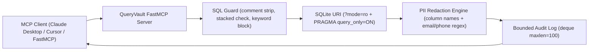

# QueryVault MCP

Read-only SQLite Model Context Protocol (MCP) server built with FastMCP and Pydantic v2. It exposes database inspection, guarded SQL execution, automatic PII redaction, query plan auditing, and z-score anomaly detection over `stdio` or Streamable HTTP with zero external API keys.

## Architecture



```
MCP Client (stdio / Streamable HTTP)
        |
        v
+---------------------------------------------------+
| QueryVault FastMCP Server                         |
|  - 5 Tools  (list, describe, query, explain, z)   |
|  - 3 Resources (schema, table sample, audit log)  |
|  - 2 Prompts (revenue drop, query performance)    |
+---------------------------------------------------+
        |
        v
+---------------------------------------------------+
| Security & Guardrails Layer                       |
|  1. Comment stripper (-- and /* */)               |
|  2. Stacked statement rejector (;)                |
|  3. Read-only prefix + blocked keyword filter     |
|  4. Identifier allowlist against sqlite_master    |
|  5. PII redactor (columns + inline regex)         |
+---------------------------------------------------+
        |
        v
SQLite (?mode=ro, PRAGMA query_only=ON, timeout=5s)
```

## MCP Primitives

### Tools (5)
- `list_tables`: Lists tables, row counts, indexes, and detected PII columns.
- `describe_table(table_name)`: Returns column types, nullability, PK/FK constraints, distinct counts, and PII flags.
- `run_readonly_query(sql, limit=50, redact_pii=True)`: Executes a single guarded `SELECT` or `WITH ... SELECT` statement with execution timing (`elapsed_ms`), row-cap enforcement, and PII redaction.
- `explain_query_plan(sql)`: Runs `EXPLAIN QUERY PLAN`, flags full table `SCAN` steps, and generates `CREATE INDEX` recommendations.
- `detect_anomalies(table_name, column_name, z_threshold=2.0)`: Computes mean, sample standard deviation, and z-score outliers on a validated numeric column.

### Resources (3)
- `db://schema`: Full JSON schema, index map, PII column inventory, and server limits.
- `db://tables/{table_name}/sample`: PII-redacted 5-row sample of a validated table.
- `db://audit/recent`: Recent in-memory audit log entries (newest first).

### Prompts (2)
- `investigate_revenue_drop`: Guided workflow chaining schema inspection, z-score anomaly detection, and grouped root-cause queries.
- `audit_query_performance`: Guided workflow chaining `explain_query_plan`, index review, and `CREATE INDEX` proposals.

## Security Invariants and Hard Caps

- **SQLite Read-Only Enforcement**: Every connection opens via `file:<path>?mode=ro` (`uri=True`) and immediately executes `PRAGMA query_only = ON`.
- **SQL Statement Guard**: Comments (`--` and `/* */`) are stripped before inspection. Stacked statements (`;` followed by non-whitespace) are rejected. Only single `SELECT`, `WITH ... SELECT`, or `EXPLAIN QUERY PLAN SELECT` statements pass. Blocked keywords (`INSERT`, `UPDATE`, `DELETE`, `DROP`, `ALTER`, `CREATE`, `REPLACE`, `TRUNCATE`, `ATTACH`, `DETACH`, `VACUUM`, `REINDEX`, `PRAGMA`, `SAVEPOINT`, `RELEASE`, `ROLLBACK`, `BEGIN`, `COMMIT`, `LOAD_EXTENSION`) are rejected outside string literals.
- **PII Redaction**: Columns matching `email`, `phone`, `mobile`, `ssn`, `api_key`, `token`, `password`, or `secret` are masked automatically. Inline email addresses (`a***@example.com`) and phone numbers (`***-***-1234`) inside free-text columns (such as `notes` or `payload`) are also redacted.
- **Hard Caps**:
  - Default query row limit: `50`
  - Maximum query row limit: `100` (requests above `100` are clamped to `100` with `truncated=True` when additional rows exist)
  - SQLite busy timeout: `5.0` seconds
  - In-memory audit log retention: `100` entries (`collections.deque(maxlen=100)`)

## Quickstart

### Local setup (project-local venv)

```powershell
python -m venv .venv
.\.venv\Scripts\Activate.ps1
pip install -e ".[dev]"
```

### Run the live showcase

```powershell
python scripts/demo_showcase.py
```

### Run the test suite

```powershell
pytest -v
```

### Run as a server

Stdio transport (default):

```powershell
queryvault-mcp --db demo.db --seed-demo --transport stdio
```

Streamable HTTP transport:

```powershell
queryvault-mcp --db demo.db --seed-demo --transport http --host 127.0.0.1 --port 8000
```

Docker:

```powershell
docker build -t queryvault-mcp .
docker run --rm -p 8000:8000 queryvault-mcp
```

## Client Configuration

### Claude Desktop (`claude_desktop_config.json`)

```json
{
  "mcpServers": {
    "queryvault": {
      "command": "C:/path/to/queryvault-mcp/.venv/Scripts/queryvault-mcp.exe",
      "args": [
        "--db",
        "C:/path/to/queryvault-mcp/demo.db",
        "--seed-demo",
        "--transport",
        "stdio"
      ]
    }
  }
}
```

### Cursor (`.cursor/mcp.json`)

```json
{
  "mcpServers": {
    "queryvault": {
      "url": "http://127.0.0.1:8000/mcp"
    }
  }
}
```
